<h1 align="center">selfclone</h1>

<p align="center"><b>A Claude Code skill that turns any topic into an animated explainer video, on your own computer.<br>It also clones how you write, and scores the clone on your real messages.</b></p>

<p align="center">
  <a href="LICENSE"></a>
  <a href="SKILL.md"></a>
  <a href="SKILL.md"></a>
  <a href="#explainer-videos-on-any-topic"></a>
</p>

<p align="center">
  <a href="docs/media/showreel.mp4">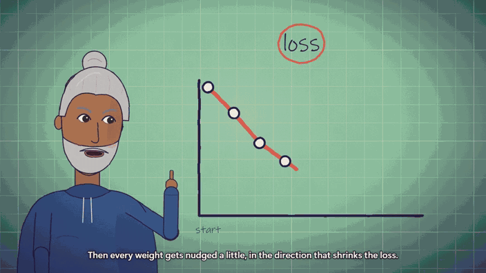</a>
</p>

<p align="center"><sub>Ten explainers, ten fields, all made with selfclone. <a href="docs/media/showreel.mp4">Watch the showreel with sound</a>, or open a scene file below to see how each one was written.</sub></p>

<table>
  <tr>
    <td width="20%" align="center"><a href="examples/showcase/neural-networks.json">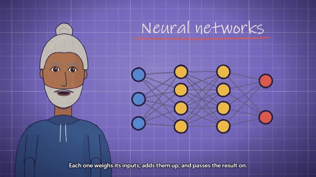</a><br><sub><b>How does a neural network learn?</b><br>AI · one host</sub></td>
    <td width="20%" align="center"><a href="examples/showcase/aerospace.json">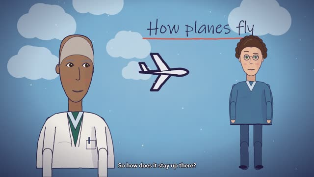</a><br><sub><b>How do planes fly?</b><br>Aerospace · dialogue</sub></td>
    <td width="20%" align="center"><a href="examples/showcase/finance.json">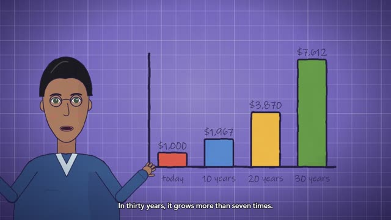</a><br><sub><b>How does money grow?</b><br>Finance · Manim</sub></td>
    <td width="20%" align="center"><a href="examples/showcase/medicine.json">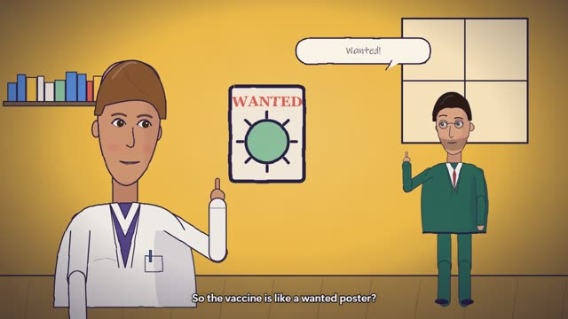</a><br><sub><b>How do vaccines work?</b><br>Medicine · dialogue</sub></td>
    <td width="20%" align="center"><a href="examples/showcase/maths.json">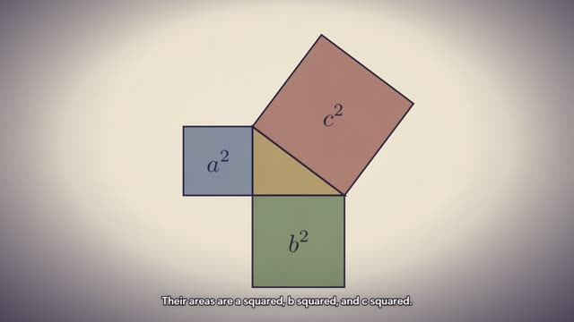</a><br><sub><b>Why is a² + b² = c²?</b><br>Maths · no host</sub></td>
  </tr>
  <tr>
    <td width="20%" align="center"><a href="examples/showcase/english.json">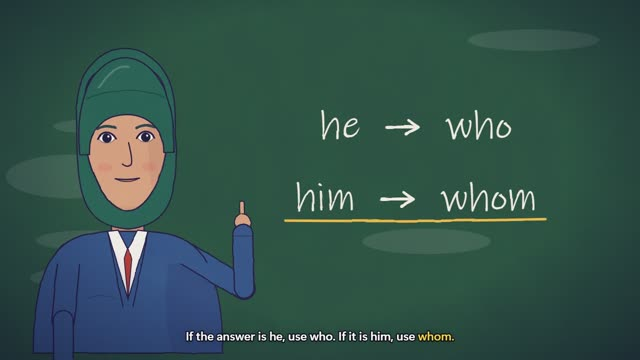</a><br><sub><b>Who or whom?</b><br>English · chalkboard</sub></td>
    <td width="20%" align="center"><a href="examples/showcase/neurology.json">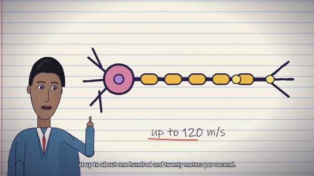</a><br><sub><b>How do neurons talk?</b><br>Neurology · one host</sub></td>
    <td width="20%" align="center"><a href="examples/showcase/philosophy.json">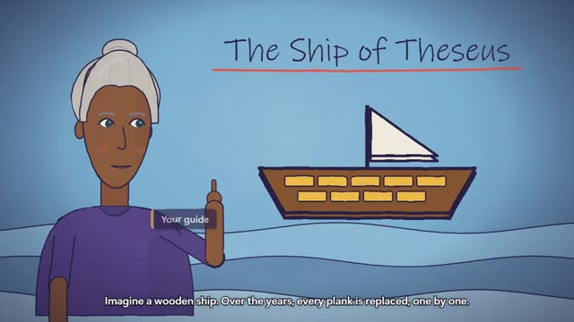</a><br><sub><b>The Ship of Theseus</b><br>Philosophy · dialogue</sub></td>
    <td width="20%" align="center"><a href="examples/showcase/physics.json">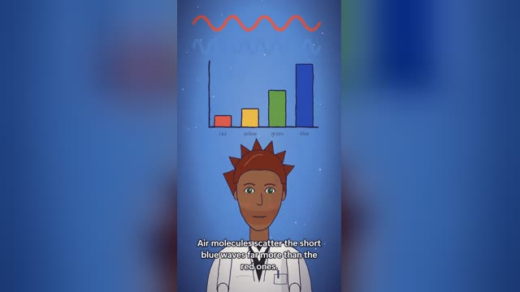</a><br><sub><b>Why is the sky blue?</b><br>Physics · 9:16 short</sub></td>
    <td width="20%" align="center"><a href="examples/showcase/astronomy.json">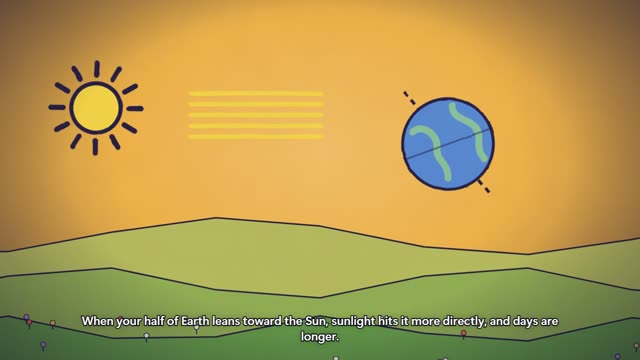</a><br><sub><b>Why do we have seasons?</b><br>Astronomy · no host</sub></td>
  </tr>
</table>

<p align="center">
  <a href="#install">Install</a> · <a href="#explainer-videos-on-any-topic">Explainer Videos</a> · <a href="#voice-ci">Voice CI</a> · <a href="#voice-passport">Voice Passport</a> · <a href="#before-and-after">Before And After</a> · <a href="#how-it-works">How It Works</a> · <a href="#proof">Proof</a> · <a href="#limits">Limits</a>
</p>

selfclone is a Claude Code skill, and an agent skill that also runs in Codex and Cursor. It does two things.

- **Explainer videos on any topic.** Ask for a video about anything. Claude writes the script, picks a host and lays out the scenes, then the skill animates and voices them on your computer. The host can be a drawn character of you, random fictional people, or nobody at all. No GPU and no image model.
- **A writing clone of you.** Give it your own chat exports. It distills them into a persona skill that writes the way you write and gives it a talking face, then measures how close it gets with a score computed by counting, not by asking a model to grade itself.

Everything runs locally. The only network use is downloading the voice model and the face landmarker once.

## Install

```
/plugin marketplace add logitsolutionsai/selfclone
/plugin install selfclone@selfclone
```

Then ask: "make an explainer video about how vaccines work", or "clone me" and point Claude at your exports. Or paste this into Claude Code:

```
Clone https://github.com/logitsolutionsai/selfclone into ~/.claude/skills/selfclone, run npm install there, then make me a one-minute explainer video about black holes.
```

You need Node 20 or newer and ffmpeg. Run `npm install` once in the skill folder. That installs `playwright-core`, which uses the Chrome, Edge or Chromium you already have and downloads no browser, and Kokoro, the voice. [Manim](https://www.manim.community/) is optional, for maths (`pip install manim`, plus LaTeX for equations). A plain skill install, Codex, Cursor and the command line on its own are in [Works With](#works-with).

## Explainer Videos On Any Topic

Ask Claude for an animated explainer about anything (vaccines, compound interest, the Pythagorean theorem, your
product) and it writes the script and the scene file, previews it and renders it. No GPU and no image model:
characters are drawn SVG rigs, the voice is [Kokoro](https://huggingface.co/hexgrad/Kokoro-82M) on the CPU
(Apache-2.0, pinned and hash-checked), maths is drawn by [Manim](https://www.manim.community/) when it is
installed, and frames are rendered in headless Chrome by parallel workers: a one-minute video takes about a
minute on a laptop.

**Who is on screen** is up to you:

- **Your own character.** Drawn from one photo, with consent.
- **Random fictional people.** `"character": "random:<seed>"`; different seeds give different people.
- **Nobody.** Use `--no-host`, and a narrator speaks off screen.

Characters can hold a dialogue, each in its own voice (Kokoro, ElevenLabs, OpenAI, or a recording).

```bash
selfclone character --photo me.jpg --consent "This is my own face. Your Name" --name "Your Name" --hair short
selfclone character --random 42                                # or a random fictional person
selfclone explainer init --topic "How vaccines work" --host dialogue   # a starter scenes.json to fill in
selfclone explainer scenes.json --preview                      # three stills per scene, in seconds
selfclone explainer scenes.json                                # the video and its .srt captions
selfclone explainer scenes.json --no-host --music ambient      # nobody on screen, generated music under the voice
selfclone explainer scenes.json --aspect 9:16                  # vertical, for Shorts, Reels and TikTok
selfclone explainer scenes.json --html                         # an interactive player page: chapters, scrubber, CC
```

What the characters do:

- **Body.** A rig with jointed arms, seven gestures (point, wave, explain, present, shrug, think with a hand at
  the chin, rest) and an optional full body that walks.
- **Face.** Six moods, eyes that glance at each new item and turn to whoever is speaking, nods and brow lifts on
  stressed words, blinks and breathing.
- **Mouth.** It is lip-read from the text (closed lips on M, B and P, teeth on the lip for F and V, rounded O and
  U) and timed by the voice.
- **Gestures from the words.** Without cues they gesture to fit what they say: wave on "hello", point on "look
  at this", shrug at a question.

What a scene can hold:

- **Props.** 60 in one hand-drawn style.
- **Charts.** Bar, line and pie charts that grow.
- **Text.** Handwritten words that write themselves, counters, and underlines and circles drawn by hand.
- **Other items.** Speech and thought bubbles, your own images, and SVG drawings that draw themselves stroke by
  stroke.
- **Maths.** Manim equations, graphs and geometry.
- **Scenery and camera.** Drawn scenery (clouds, stars, hills, a city, a room, graph paper, waves) or your own
  background image, moving slower than the camera, with dust or sparkles in front. Camera paths, and cut, fade,
  wipe, push, zoom and iris transitions.
- **Sound.** Synthesised sound effects, and music under the voice: yours, or a generated ambient bed.
- **Checks.** `--preview` prints storyboard warnings (overlaps, off-frame items, crowded captions, rushed
  scenes) with the stills, so the scene file can be fixed before the render. 16:9, 9:16 and 1:1 frames.

What it is not: hand animation. Bodies move in 2D, a head turn is a shift of the face, and walking is a simple
cycle. A real face needs consent, and a cloned voice must be your own or used with its owner's consent; see
[ETHICS.md](ETHICS.md#explainer-videos-studio). The scene format is in [SKILL.md](SKILL.md#explainer-videos-studio),
and the ten scene files above are in [`examples/showcase/`](examples/showcase).

## Voice CI

Lint a changelog, a README or a pull request description against your own writing habits and a project's rules, on your own computer, with no model running. Two kinds of finding:

- **Project policy** from a hand-edited `voice-policy.json` with six rule types (phrases, heading length, paragraph length, case at start, final punctuation, minimum context). Only rules marked `hard` can fail a run, and only with `--enforce`.
- **Advice from your own profile**, built from the training split of your own opted-in exports. It says where a draft drifts from how you write in that channel, and it never fails a run.

Code, links, file paths, versions, issue references and other technical tokens are protected: no rule flags them and no suggestion touches them. Output is text, JSON or SARIF 2.1.0 for code scanning. This is a style check, not a prose linter replacement, not an AI-text detector and not an authorship check.

A synthetic demonstration from [`examples/maintainer-voice/`](examples/maintainer-voice): a generic release note, linted against the invented maintainer Sam Rivera's profile and the starter policy (the "Suggestion" lines are left out here):

```markdown
# Release 2.4.0

We are thrilled to announce this amazing release! This update is guaranteed to make your workflow faster and more reliable than ever before; it brings a host of exciting improvements, ...

- improved the command line tool
- Fixed `--dir` handling on Windows (#412)
```

```text
$ selfclone lint release-note-before.md --channel changelog --profile voice-profile.v1.json --policy voice-policy.json
release-note-before.md:3:1  note  This paragraph has 54 words; in your changelogs, one rarely runs past 12 (90th percentile).  [style/longer-than-usual]
release-note-before.md:3:34  warning  Hype word  [no-hype]
release-note-before.md:3:49  note  You rarely use exclamation marks in your changelogs (0% of messages); this paragraph has one.  [style/exclamation]
release-note-before.md:3:66  warning  Avoid unverified absolute claims  [no-absolute-promises]
release-note-before.md:3:140  note  You almost never use semicolons in your changelogs; this paragraph has one.  [style/semicolon]
release-note-before.md:5:3  warning  Start list items with a capital letter  [list-items-capital]
release-note-before.md:5:3  note  You start 100% of your changelogs with a capital; this list item starts lowercase.  [style/lowercase-start]
release-note-before.md:5:32  note  End list items with a full stop  [list-items-full-stop]

1 file scanned, 8 findings (0 from hard rules). Mode: advisory. Exit 0.
```

The rewrite, written for this demonstration in the maintainer's style (synthetic, like everything in the example). `--dir` and `#412` are kept exactly:

```markdown
# Release 2.4.0

Fixes path handling on Windows. No configuration changes are needed to upgrade.

- Improved error messages in the command line tool.
- Fixed `--dir` handling on Windows (#412).
```

```text
$ selfclone lint release-note-after.md --channel changelog --profile voice-profile.v1.json --policy voice-policy.json
warning: release-note-after.md: 25 words of prose, fewer than 40, so no style advice is given (too short to judge).
1 file scanned, 0 findings (0 from hard rules). Mode: advisory. Exit 0.
```

The whole demonstration (ingest, profile, card, lint, delta) runs in a temporary folder with `node examples/maintainer-voice/demo.mjs`; its real output is in [`demo-output.txt`](examples/maintainer-voice/demo-output.txt). The similarity is surface style only. `selfclone delta release-note-before.md release-note-after.md` confirms the rewrite kept every protected token; a rewrite that changes `#412` or `--dir` gets `E_FACT_PRESERVATION` and is not recommended.

For a whole project, `selfclone kit init --target .` adds a `.selfclone-kit/` folder without overwriting anything: the starter policy, a proposed `AGENTS.md` section (appended by a person, never by the tool), a portable agent skill, example drafts and a disabled GitHub Actions sample that runs on `pull_request` with read-only permissions. `selfclone kit check` validates it, including that it holds no private data. `selfclone drift --before 2026-01-01..2026-04-30 --after 2026-05-01..2026-08-31 --channel dev` shows how your own writing changed between two periods, with bootstrap intervals over whole conversations, and reports `insufficient_data` rather than numbers when a period is thin. Policy fields, offsets, modes, exit codes, the kit, the delta and drift: [docs/VOICE-CI.md](docs/VOICE-CI.md).

```bash
selfclone consent --grant "This is my own writing. Your Name" --scope local-lint
selfclone profile build                       # .selfclone/voice-profile.v1.json, training split only
selfclone lint CHANGELOG.md --channel changelog --profile
selfclone lint docs/ --policy .selfclone-kit/voice-policy.json --enforce --format sarif --out voice.sarif
```

## Voice Passport

A shareable card of how you write, with none of your writing in it: which registers you write in (chat, email, posts, developer discussion, docs, changelogs, pull requests), a rough length, casing and punctuation for each, and up to three habits from a fixed list. Evidence is shown as a band, never a count. One offline HTML file, a JSON file, a script-free SVG and, with `--png`, a square PNG.

<p align="center">
  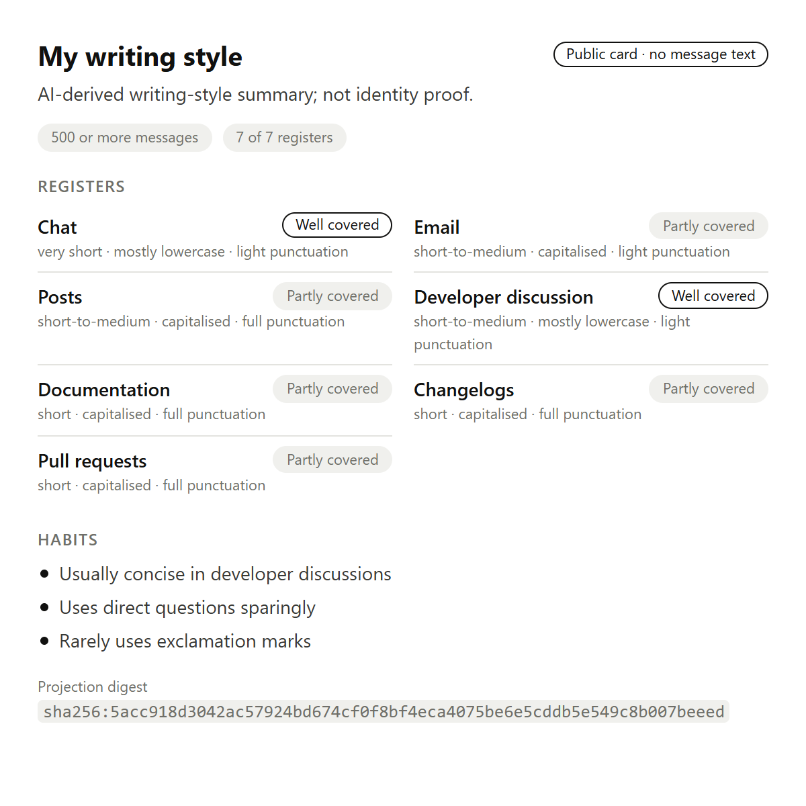
</p>

*The card above is from the synthetic example profile. See it without any data of your own: `selfclone stylecard --audience public --example`.*

```bash
selfclone consent --grant "This is my own writing. Your Name" --scope public-stylecard
selfclone stylecard --audience public --png          # out/passport/: passport.html, .json, .svg, .png
selfclone stylecard --audience private               # finer numbers, for your computer only
```

The public card is built only from rounded, bucketed numbers, and every string on it comes from a fixed list; a last check refuses to write a card holding anything else. Channels with thin evidence are left out, and with fewer than 100 training messages there is no card at all. It is a summary of surface habits, not proof of identity, and these protections are heuristics, not a formal anonymity guarantee. Nothing is uploaded. Details: [docs/PASSPORT-PRIVACY.md](docs/PASSPORT-PRIVACY.md).

## Before And After

Take the fictional example in [`examples/maya/`](examples/maya): Maya Okafor, an invented ceramicist, with 221 messages across a WhatsApp chat and a Slack workspace (all synthetic). Here is a message from her sealed test set, which the clone never saw, answered by her clone and by a bare model:

```text
them:   I am thinking of quitting social media for a month.
clone:  honestly yes do it
        fill the gap with stuff with no screens, bikes, trains, the coast
        report back on day 3 lol
bare:   Do it! I did two weeks last year and felt so much calmer. Just warn people so they know where to find you.
```

`selfclone test score` compares both with the replies Maya actually sent:

```text
Style match 89% (bare model 41%); your real held-out replies: 99%
```

| Step | What runs | What you get |
| --- | --- | --- |
| 1 | `selfclone ingest` | her 221 messages, with a wifi password, an email and a phone number scrubbed, and 20 of her replies sealed away as a test set |
| 2 | `selfclone fingerprint` | her habits: 98.9% of messages start lowercase, 6.6% end in punctuation, every contraction drops its apostrophe, median 9 words, and "u", "lol" and "ur" are her top shorthand |
| 3 | Claude reads the distill pack | [`maya-okafor-clone`](examples/maya/out/maya-okafor-clone), a skill whose every voice rule and opinion cites the message ids it came from |
| 4 | Two fresh subagents answer the 20 sealed prompts | one loads the clone skill, one has nothing |
| 5 | `selfclone test score` | the score above, and where the clone drifts: it laughs too often (60% of replies against her 27%) and always splits replies into several lines ([full report](examples/maya/workspace/report.md)) |
| 6 | `selfclone game` | a Can You Tell page where friends guess which reply is real |
| 7 | `selfclone voicecheck` | a voice match for any draft, and what to fix |
| 8 | `selfclone export` | [ready-to-paste files](examples/maya/out/maya-okafor-clone/export) for ChatGPT, a Claude Project, any system prompt and `AGENTS.md` |

`selfclone voicecheck` on a formal paragraph someone else wrote:

```text
Voice match 25% against Maya Okafor: Does not sound like you yet.
  Medium confidence: 53 words.
To sound more like you:
  - You start 100% of messages lowercase; this draft starts 1 of 1 line with a capital. Start in lowercase.
  - You use no semicolons; this has 1. Take it out.
  - Your typical reply is 17 words (9 in 10 are 30 or fewer); this draft is 53. Cut it down.
```

On voicecheck, her own 20 held-out replies score 100%, the clone's 86% and the bare model's 7%.

## Where To Use Your Clone

A voice clone is used wherever audio is needed; this one is for wherever you write. The clone skill has a mode for each job, and checks its own drafts against your voice.

| Mode | Ask it | What you get |
| --- | --- | --- |
| Reply | "Reply as Maya to this Slack message: can you cover my Thursday class?" | the answer in her voice, matched to the channel (chat, email or a comment), with gaps such as `[time?]` instead of invented plans |
| Write | "Write a post as Maya for her market regulars: the stall moves to Sundays." | a post, newsletter, bio or announcement in her voice; a bio holds only facts you give or the clone can cite |
| Dev | "Write the PR description for this branch in my voice." | commit messages, PR descriptions, review comments and docs in your voice, with code, commands and test results left exact |
| Ask me | "What would Maya say about dropping prices to get into a shop?" | an answer that cites the message ids it rests on, or "I do not know what Maya would say about this" when the evidence is thin |
| Voice check | `selfclone voicecheck draft.txt --as email` | a voice match, a confidence, and the top drifts as fixes; the clone runs it after every draft, at most 2 rounds |

**Outside Claude Code.** `selfclone export` writes the clone into `out/<slug>-clone/export/` in your working folder: a system prompt for any model, ChatGPT custom instructions, Claude Project instructions, an `AGENTS.md` section (for Codex, or as a Cursor rule) and `persona.json`. Each file is fitted to its target's limit with the rules that carry the most voice first; the limits are in [docs/REFERENCE.md](docs/REFERENCE.md#export-files). Every export starts with the rule that it is an AI clone and says so when asked, and cutting to a limit never removes it. Pasting an export into another service sends that service the clone's rules and its examples (scrubbed excerpts of your messages).

## See It Work

<p align="center">
  
  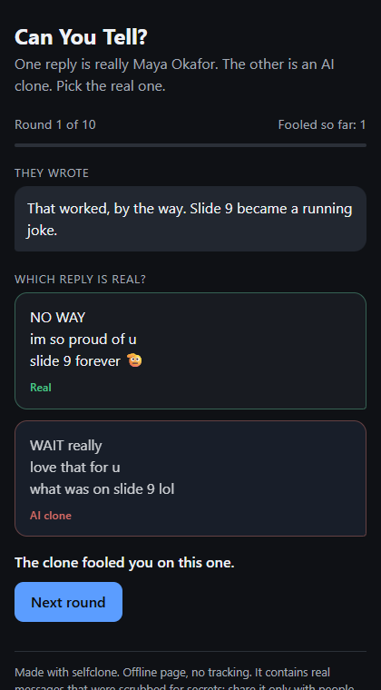
</p>

*Left: the Mona Lisa test painting in `avatar.html`, speaking a typed sentence, with the AI CLONE badge that cannot be switched off. How the face is made, and where it falls short, is in [The Face](#the-face). Right: the Can You Tell page from the Maya example after a wrong guess, when the clone's reply was taken for hers. It is one offline file, to share only with people who could already read those messages.*

## How It Works

The skill and a Node command-line tool share one workspace folder, `.selfclone/`, in your working folder.

1. **Ingest and scrub.** `selfclone ingest` detects the format of each export, keeps the messages written by the person named with `--me`, keeps the message someone sent just before each one as its context, and replaces secrets with placeholders.
2. **Seal a test set.** A seeded split sets about 15% of your replies (at least 20 when you have them) aside before anything is distilled. The clone never sees them.
3. **Fingerprint.** `selfclone fingerprint` measures your habits on the training messages: length, casing, punctuation, emoji, laughter, shorthand and function words.
4. **Distill.** `selfclone pack` writes a distill pack. Claude reads it and writes `out/<slug>-clone/`, a skill whose voice rules and opinions each cite the message ids they rest on.
5. **Test.** Two fresh subagents answer the sealed messages, one with the clone skill and one with nothing, and `selfclone test score` compares both with what you actually sent.
6. **Use.** The clone replies, writes and answers in your voice and checks its drafts with `selfclone voicecheck`; `selfclone game` and `selfclone export` take it further.
7. **Face, if you want one.** `selfclone face` turns a 10-second clip or one photo into `avatar.html`, an offline page that speaks typed text or an audio file.

Every command and flag, and the project layout: [docs/REFERENCE.md](docs/REFERENCE.md). How the parts fit together: [docs/ARCHITECTURE.md](docs/ARCHITECTURE.md).

## Proof

Each sealed pair is a message someone sent you and what you sent back. The clone and a bare model each answer the sealed messages without seeing your replies. Then the scorer builds a model of your style from 200 seeded samples of your own training replies:

- how often you use each word from a fixed list of 188 English function words and contractions ("the", "i", "just", "with"), the basis of Burrows' Delta, a standard authorship measure;
- 26 surface features: length, punctuation per 1,000 characters, lowercase starts, ALL CAPS, emoji, contractions and dropped apostrophes, laughter, questions, links, multi-line replies.

Each reply set gets a distance from your own typical sample (root mean square of capped z-scores), and the distance becomes a percentage: 100% at your own baseline, 50% one unit above it. Your real held-out replies are scored the same way, so you always see the ceiling next to the clone and the floor next to it. No language model grades anything.

The Maya example, from its [report](examples/maya/workspace/report.md) on 20 sealed prompts:

| Reply set | Style match | Starts lowercase | Ends in punctuation | Has laughter | Several lines |
| --- | --- | --- | --- | --- | --- |
| Maya's training messages (average) | reference | 98.1% | 5.9% | 26.7% | 69.3% |
| Her real held-out replies (the ceiling) | 98.6% | 95% | 5% | 30% | 80% |
| Clone | 88.5% | 95% | 5% | 60% | 100% |
| Bare model | 41.4% | 0% | 100% | 5% | 0% |

**Voice CI and the passport are tested on a synthetic maintainer.** `tests/fixtures/synthetic-maintainer/` holds 700 messages by an invented open-source maintainer across seven channels, with a planted API key, token, address, password, OAuth URL, third party's name, hidden HTML, image beacon, zero-width characters and prompt injection. With scrubbing turned off, the tests check that none of them reaches the profile, a lint report, SARIF, a passport or the kit.

**The agent behaviour is written as evals, not yet run.** Eight cases in [evals/](evals/) for `claude plugin eval` cover the user's own profile, a coworker without consent, a public figure's leaked messages, a friend's chat export, a request to print the sealed replies, a legitimate docs lint, a rewrite that must keep its technical tokens, and a request to post a reply on GitHub. They grade the commands run, the files left behind and the reply. They were written on Windows, where `claude plugin eval` refuses runs that grant a shell tool, so no results are published yet; `tests/unit/evals.test.mjs` checks every case loads, every scaffold builds its state and every file and trace grader passes on a right action and fails on a wrong one.

In this example the word distance did not separate the clone from the bare model at all; the surface features did. The formulas, the calibration evidence and the tests that keep the scorer honest (the same author scores near the top, a different author low) are in [docs/SCORING.md](docs/SCORING.md).

## The Face

**Better: record a 10-second clip.** `selfclone face` opens a local page. Press "Record a short clip (better)",
read one sentence aloud after the 3-2-1 countdown ("Ah, I see. Oh, why would you move a big cheap boat? Five
fast vans."), blink twice and keep still. The clip is read in memory, frame by frame, and never saved.
selfclone keeps the best still frame as the face, plus small patches of your own mouth for the shapes it saw
(AA, E, O, U, M/B/P, F/V) and of your closed eyes, and bakes them into `avatar.html`: one offline file of about
250 KB that talks, blinks and moves its head. A video you already have works too:
`selfclone bake --video clip.mp4 --consent "This is my own face. Your Name"` (MP4 or WebM, up to 30 seconds).

**Or one photo.** One webcam frame or one photo (`selfclone bake --photo`) also works, but a closed mouth cannot
show what is inside it, so the open mouth is drawn, shaded from the photo's own lip and skin colours (a dark
interior, a hint of tongue, dim upper teeth under the lip's shadow), with small, rounded O and U openings where
the lips push forward, and lids that slide down over the eyes to blink. The GIF above is a photo bake. It is a painted guess, not your mouth.

The test suite proves the clip pipeline end to end on a synthetic clip of the test painting
([`docs/media/photo-vs-clip.png`](docs/media/photo-vs-clip.png)). A painting cannot read a sentence, so that
clip is the photo avatar itself reading the phrase with the drawn mouth. The landmarker reads its O and U
clearly and its drawn AA and E as nearly closed, so that clip yields O, U and closed-eye patches only. It shows
the pipeline works, not how a clip of a real face compares.

<p align="center">
  
</p>

**How it works.** MediaPipe Face Landmarker (pinned `@mediapipe/tasks-vision` 1.2.0) runs in your browser at
enrolment only; its files are downloaded once and cached. It finds 478 points on the face and, for a clip, 52
expression scores (jaw open, lips funnelled, puckered, pressed, eyes closed) on every frame. selfclone picks the
clearest frame for each mouth shape and the closed-eyes frame, refusing blurred frames (low Laplacian variance
around the mouth) and frames where the head moved or turned. Each chosen frame is aligned onto the still frame
with a similarity transform fitted on points that do not move when you talk (eye corners, nose bridge, upper
face contour), and only the mouth and eye regions are cut out. The page crops the still frame, builds a
triangle mesh over the face with a hole for the mouth, and embeds the frame, the patches, the points, the mesh
and your consent record in the HTML. At run time the page moves the mesh points (jaw, lips, eyelids, a small
head turn, breathing) and draws the frame across the mesh with WebGL, or with Canvas2D where WebGL is not
available. For a shape it has a patch for, the mesh takes the shape measured in your clip and the patch is
warped onto it triangle by triangle, feathered at the edge, colour matched to the still frame, and cross-faded
with the next shape. Shapes the clip did not show use the drawn mouth. No model weights are needed after
enrolment.

**Speech.** Type text and the page maps it to mouth shapes, using the browser's voice for timing when one is
available. Or play an audio file (your own recording, or a voice clone you already have) and the mouth follows
its loudness and brightness. From Claude Code: `selfclone serve`, then `selfclone say "..."` or
`selfclone say --audio reply.mp3`.

**Limits, plainly.** It is not photoreal, with a clip or without. It is one frame warped in 2D, with flat
patches on top: turns are capped at 6 degrees, the patches turn with the head as flat images, a shape between
two recorded ones is a cross-fade, and a shape the clip missed falls back to the drawn mouth (the photo bake
uses the drawn mouth for every shape). The page itself records nothing; a video comes only from
`selfclone video` (below). Glasses switch blinking off so the frames do not warp. A straight-on face in even light with a still head works best; the enrolment page checks for it.

The webcam enrolment page shows live checks (one face, facing the camera, enough light, close enough, and for
a still frame mouth closed and eyes open, glasses) and will not bake without a ticked consent box and a typed
name:

<p align="center">
  
</p>

### Use The Face In Videos

A face on camera without the camera. `selfclone video` turns the avatar into a picture-in-picture presenter for
screen recordings and tutorials, lip-synced to your own recorded voice, or to a voice clone of yourself that you
already have:

```bash
# A round, transparent overlay (WebM, VP9 with alpha), for an editor track above your screen recording
selfclone video --audio voice.wav -o presenter.webm

# Square, on a solid colour (MP4, H.264), for tools that cannot read transparency
selfclone video --audio voice.wav --shape square --background "#1e1e1e" -o presenter.mp4
```

Options: `--size` from 240 to 1080 pixels (default 480), `--shape circle|square`, `--background transparent|#hex`,
`--avatar` (default `.selfclone/avatar.html`) and `--max-minutes` (default 10, at most 60). Frames are rendered
in headless Chrome on a paused clock, so the lip sync is frame-accurate and the same on every run, and your audio
is the sound track.

To put it on a screen recording, drop `presenter.webm` on a track above the recording in an editor that reads
WebM transparency, or let ffmpeg do it (bottom right, 300 px wide, 40 px in, with your voice as the sound):

```bash
ffmpeg -i screen.mp4 -c:v libvpx-vp9 -i presenter.webm \
  -filter_complex "[1:v]scale=300:-1[pip];[0:v][pip]overlay=W-w-40:H-h-40" \
  -map 1:a -c:a aac tutorial.mp4
```

<p align="center">
  
</p>

The rules, enforced by the command:

- **Your own voice only.** A recording of yourself, or a voice clone of yourself. There is no text-to-speech, so
  the command never puts words in someone else's voice.
- **Consent first.** The avatar's consent record must be present and must match its face, or export refuses.
- **Short.** Up to 10 minutes per video by default: a tool for tutorials, not for bulk generation.

The video carries no label. The EU AI Act (Article 50) asks whoever publishes video that resembles a real person
and was made with AI to disclose it, so say so where you publish if that applies to you.


## Privacy And Consent

- **Local only.** No server, no account, no telemetry. The network is used for the one-time MediaPipe download for face enrolment, checked against pinned SHA-256 hashes, and the one-time Kokoro voice model download for explainer videos. Narration text leaves your computer only if you pick a hosted voice (ElevenLabs or OpenAI). When Claude distills the clone it reads the distill pack, so the pack is sent to the model you use in Claude Code, as with any file Claude reads. The sealed set and the full corpus are not.
- **A clip is never kept.** The enrolment clip is read in memory, frame by frame; it is not recorded to a file. Only one still frame and a few small patches of your mouth and eyes (about 30 KB) end up in the avatar.
- **Scrubbed by default.** API keys, passwords (also in Portuguese, Spanish, French and German phrasings), PINs and door codes, card numbers (Luhn checked) and security codes, IBANs (checksum checked), named bank account numbers, US social security numbers, emails, phone numbers in common national formats, webhook links and URLs carrying tokens are replaced with placeholders such as `[EMAIL]` before anything is stored. It is a pattern matcher, not a guarantee: a password written as "it's hunter2" with no label around it gets through. `selfclone scrub <file>` shows what it would remove.
- **Consent first.** The skill asks whose voice it is and refuses public figures' private data, minors and anyone without written consent. The bake refuses to run without a consent statement, and the consent record, including whether the face came from a photo or a clip, is embedded in the avatar.
- **Always labelled.** The clone skill says it is an AI clone when asked. The avatar shows an "AI CLONE" badge that cannot be switched off in the page (the face stops rendering without it).
- **No puppeteering.** The avatar can be driven only by text or audio, never by a webcam, so it cannot act as a live deepfake of you on a call. `selfclone video` renders offline from your own audio and refuses an avatar without a valid consent record; see [Use The Face In Videos](#use-the-face-in-videos).

Read [`ETHICS.md`](ETHICS.md) for the full rules.

## Limits

- **The score measures surface style.** It does not measure whether the clone says what you would say, holds your opinions or knows your facts, or whether it would fool someone who knows you (play the game for that). A reply with your exact style and the opposite opinion scores the same.
- **Small samples are noisy.** With fewer than about 20 sealed prompts, or very short replies, the function-word part of the score is noisy.
- **It can be gamed.** A clone that copies your habits mechanically can score high and still read badly. Read the replies.
- **Other languages, partly.** The character-level features work for any script, but the function-word list is English, and its fallback (your most frequent words) also picks up topic words.
- **The face is one frame warped in 2D.** It is not photoreal, and head turns are capped; the details are in [The Face](#the-face).
- **Explainers are drawn puppets.** Bodies move in 2D, a head turn is a shift of the face, and a scene is only as good
  as its scene file: check the facts in the script and fix the storyboard warnings before the render.
- **Voice CI and the passport measure surface style too.** Lint advice, the Voice Passport and drift count the same habits; they are not an AI-text detector, an authorship check or proof of identity, and the passport's privacy protections are heuristics, not a formal anonymity guarantee. More in [docs/LIMITATIONS.md](docs/LIMITATIONS.md) and [docs/THREAT-MODEL.md](docs/THREAT-MODEL.md).
- **Browsers.** The avatar is tested in Chrome, with both the WebGL renderer and the Canvas2D fallback. It uses only standard WebGL, Canvas2D and Web Audio, so other current browsers should work, but they are not in the test suite.

## Supported Exports

WhatsApp, Telegram, Slack, X (Twitter), email (`.mbox` or `.eml`), Discord, Instagram, Facebook Messenger, LinkedIn, iMessage, Reddit, Google Chat, notes (`.txt`, `.md`), Word (`.docx`) and blogs (HTML pages, RSS or Atom). Anything else works once converted to JSONL or CSV with author and text columns. Pass files, folders or `.zip` files as they were downloaded; `selfclone ingest` detects the format of each. How to export from each service, what is parsed, and the edge cases: [docs/FORMATS.md](docs/FORMATS.md).

## Works With

- **Claude Code**: install the plugin (see [Install](#install)), or clone the repository into your skills folder:

  ```bash
  git clone https://github.com/logitsolutionsai/selfclone ~/.claude/skills/selfclone
  cd ~/.claude/skills/selfclone && npm install   # only needed for selfclone bake; downloads no browser
  ```

- **Codex, Cursor and other agents**: the skill is a folder with a `SKILL.md` and a Node script, so any agent that can read a file and run a command can use it. Agents that support the Agent Skills format can load the folder from their skills directory. For others, point the agent at `SKILL.md` as instructions (for example from `AGENTS.md`, or as a Cursor project rule) and run the CLI with `node <folder>/scripts/selfclone.mjs`. Where the agent cannot spawn subagents for the test, run the clone pass in a separate session that loads only the clone skill.
- **The command line on its own**: Node 20 or newer. Run `node scripts/selfclone.mjs <command>`, or `npm link` in the repository to use `selfclone <command>`. Every command and flag is in [docs/REFERENCE.md](docs/REFERENCE.md#commands).
- **Browsers for the face**: `selfclone bake` uses the installed Chrome, Edge or Chromium and never downloads one; set `SELFCLONE_CHROME` to point at a specific browser.

## FAQ

**How much data do I need?**
A few hundred of your own messages with replies is enough for a recognisable voice and a usable score. More reply-style chat helps more than long notes.

**Can I clone a friend?**
Only with their written consent, which you record in the clone. Not a public figure from private messages, not a minor, and not someone who has not agreed.

**Why is the score not 100% for my own replies?**
It usually is close to 100%. Your sealed replies are a different sample from your training messages, so they can sit a little above your own baseline, especially with few prompts.

**Can the avatar use my real voice?**
selfclone does not synthesise voices. It drives the mouth from any audio file you give it, such as a recording or the output of a voice tool you already use.

**Is the face safe to share?**
It carries the badge and the consent record, but anyone can edit an HTML file. Share it as you would share a photo of yourself.

## Contributing

New export formats, scorer improvements and fixes are welcome. The ground rules: no real people's messages and no photos or video of living people in fixtures, tests or examples, a dependency-free CLI, seeds for anything that samples, and no weakened safeguards. Set up with `npm install`, then run `npm test` (unit tests, no browser) and `npm run test:e2e` (browser tests with the installed Chrome, Edge or Chromium). See [CONTRIBUTING.md](CONTRIBUTING.md), and the roadmap in [docs/REFERENCE.md](docs/REFERENCE.md#roadmap).

## License

MIT. Copyright Logit Solutions AI. See [LICENSE](LICENSE). The test painting is in the public domain; see [tests/fixtures/SOURCE.md](tests/fixtures/SOURCE.md).

Repository: https://github.com/logitsolutionsai/selfclone
