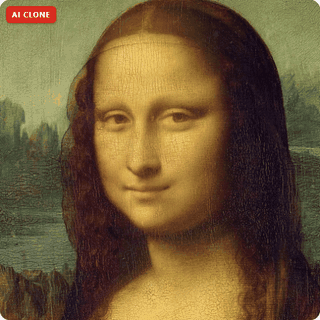
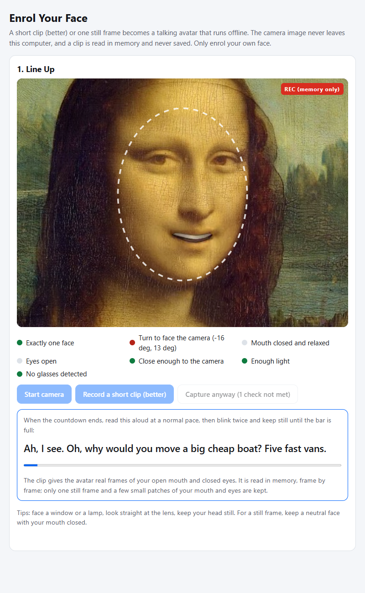

# selfclone

**Clone yourself. It writes like you, thinks like you, has your face, and proves how close it gets.**

<p align="center">
  
</p>

selfclone is an open-source agent skill for Claude Code (and other agents that read skills). You give it your
own chat exports. It distills them into a persona skill that writes the way you write, gives that persona an
offline talking face made from a 10-second clip (or one selfie), and measures how close the clone gets with a
score computed by counting, not by asking a model to grade itself. Privacy-first: everything stays on your
computer.

The face above is the Mona Lisa, a public domain painting used as the test face. selfclone never ships or tests
with photos or video of living people.

## What You Get In 30 Seconds

Take the fictional example in [`examples/maya/`](examples/maya): Maya Okafor, an invented ceramicist, with 221
messages across a WhatsApp chat and a Slack workspace (all synthetic).

1. `selfclone ingest` keeps her 221 messages, scrubs a wifi password, an email and a phone number, and seals
   20 of her replies away as a test set.
2. `selfclone fingerprint` measures her habits: 98.9% of messages start lowercase, 6.6% end in punctuation,
   every contraction drops its apostrophe, median 9 words, "u", "lol" and "ur" are her top shorthand.
3. Claude reads the distill pack and writes [`maya-okafor-clone`](examples/maya/out/maya-okafor-clone), a skill
   whose every voice rule and opinion cites the message ids it came from.
4. Two fresh subagents answer the 20 sealed prompts: one loads the clone skill, one has nothing.

```text
them:   I am thinking of quitting social media for a month.
clone:  honestly yes do it
        fill the gap with stuff with no screens, bikes, trains, the coast
        report back on day 3 lol
bare:   Do it! I did two weeks last year and felt so much calmer. Just warn people so they know where to find you.
```

5. `selfclone test score` compares both against the replies Maya actually sent:

```text
Style match 89% (bare model 41%); your real held-out replies: 99%
```

The report also shows where the clone drifts: it laughs too often (60% of replies against her 27%) and always
splits replies into several lines. See the full [report](examples/maya/workspace/report.md).

6. `selfclone game` writes a Can You Tell page where friends guess which reply is real.

<p align="center">
  
</p>

## Quick Start

### Claude Code Plugin

```text
/plugin marketplace add logitsolutionsai/selfclone
/plugin install selfclone@selfclone
```

Then say "clone me" and point Claude at your exports. The skill walks through consent, ingest, distillation,
testing and the optional face.

### Plain Skill Install

```bash
git clone https://github.com/logitsolutionsai/selfclone ~/.claude/skills/selfclone
cd ~/.claude/skills/selfclone && npm install   # only needed for the photo bake; downloads no browser
```

**Codex, Cursor and other agents.** The skill is a folder with a `SKILL.md` and a Node script, so any agent that
can read a file and run a command can use it. Agents that support the Agent Skills format can load the folder
from their skills directory. For others, point the agent at `SKILL.md` as instructions (for example from
`AGENTS.md`, or as a Cursor project rule) and run the CLI with `node <folder>/scripts/selfclone.mjs`. Where the
agent cannot spawn subagents for the test, run the clone pass in a separate session that loads only the clone
skill.

### CLI On Its Own

Node 20 or newer. No runtime dependencies apart from `playwright-core` for `selfclone bake`.

```bash
node scripts/selfclone.mjs ingest "WhatsApp Chat with Sam.zip" slack-export.zip --me "Your Name"
node scripts/selfclone.mjs fingerprint
node scripts/selfclone.mjs pack
node scripts/selfclone.mjs test prompts
# ...answer .selfclone/test-prompts.json with your clone and with a bare model, saving
# [{"id": "...", "reply": "..."}] as .selfclone/clone-replies.json and .selfclone/bare-replies.json...
node scripts/selfclone.mjs test score --clone .selfclone/clone-replies.json --bare .selfclone/bare-replies.json
node scripts/selfclone.mjs game            # uses the clone replies you just scored
node scripts/selfclone.mjs face            # webcam enrolment: a 10-second clip (better) or one frame, or:
node scripts/selfclone.mjs bake --video me.mp4 --consent "This is my own face. Your Name" --name "Your Name"
node scripts/selfclone.mjs bake --photo me.jpg --consent "This is my own face. Your Name" --name "Your Name"
node scripts/selfclone.mjs serve           # then, from another terminal:
node scripts/selfclone.mjs say "hello, I am an AI clone"
```

`npm link` in the repository makes the same commands available as `selfclone ...`.

## How The Score Works

Before anything is distilled, about 15% of your replies (at least 20 when you have them) are sealed: the
message someone sent you, and what you sent back. The clone and a bare model each answer the sealed messages.
Then the scorer builds a model of your style from 200 seeded samples of your own training replies:

- how often you use each word from a fixed list of 188 English function words and contractions ("the", "i",
  "just", "with"), the basis of Burrows' Delta, a standard authorship measure;
- 26 surface features: length, punctuation per 1,000 characters, lowercase starts, ALL CAPS, emoji, contractions
  and dropped apostrophes, laughter, questions, links, multi-line replies.

Each reply set gets a distance from your own typical sample (root mean square of capped z-scores), and the
distance becomes a percentage: 100% at your own baseline, 50% one unit above it. Your real held-out replies are
scored the same way, so you always see the ceiling next to the clone and the floor next to it.

**What it does not measure:** whether the clone says what you would say, holds your opinions or knows your
facts, or whether it would fool someone who knows you (play the game for that). It is noisy with fewer than 20
sealed prompts. It can be gamed by copying habits mechanically. The formulas and calibration evidence are in
[`docs/SCORING.md`](docs/SCORING.md).

## The Face

**Better: record a 10-second clip.** `selfclone face` opens a local page. Press "Record a short clip (better)",
read one sentence aloud after the 3-2-1 countdown ("Ah, I see. Oh, why would you move a big cheap boat? Five
fast vans."), blink twice and keep still. The clip is read in memory, frame by frame, and never saved.
selfclone keeps the best still frame as the face, plus small patches of your own mouth for the shapes it saw
(AA, E, O, U, M/B/P, F/V) and of your closed eyes, and bakes them into `avatar.html`: one offline file of about
250 KB that talks, blinks and moves its head. A video you already have works too:
`selfclone bake --video clip.mp4 --consent "This is my own face. Your Name"` (MP4 or WebM, up to 30 seconds).

**Or one photo.** One webcam frame or one photo (`selfclone bake --photo`) also works, but a closed mouth cannot
show what is inside it: the open mouth is drawn (a dark cavity, a tongue, two teeth bands), O and U stay
lens-shaped, and a blink stretches the eyelid skin.

The test suite proves the clip pipeline end to end on a synthetic clip of the test painting
([`docs/media/photo-vs-clip.png`](docs/media/photo-vs-clip.png)). A painting cannot read a sentence, so that
clip is the photo avatar itself reading the phrase, and both bakes look alike. It shows the pipeline works,
not how a clip of a real face compares.

<p align="center">
  
</p>

**How it works.** MediaPipe Face Landmarker (pinned `@mediapipe/tasks-vision` 1.2.0) runs in your browser at
enrolment only; its files are downloaded once and cached. It finds 478 points on the face and, for a clip, 52
expression scores (jaw open, lips funnelled, puckered, pressed, eyes closed) on every frame. selfclone picks the
clearest frame for each mouth shape and the closed-eyes frame, refusing blurred frames (low Laplacian variance
around the mouth) and frames where the head moved or turned. Each chosen frame is aligned onto the still frame
with a similarity transform fitted on points that do not move when you talk (eye corners, nose bridge, upper
face contour), and only the mouth and eye regions are cut out. The page crops the still frame, builds a
triangle mesh over the face with a hole for the mouth, and embeds the frame, the patches, the points, the mesh
and your consent record in the HTML. At run time the page moves the mesh points (jaw, lips, eyelids, a small
head turn, breathing) and draws the frame across the mesh with WebGL, or with Canvas2D where WebGL is not
available. For a shape it has a patch for, the mesh takes the shape measured in your clip and the patch is
warped onto it triangle by triangle, feathered at the edge, colour matched to the still frame, and cross-faded
with the next shape. Shapes the clip did not show use the drawn mouth. No model weights are needed after
enrolment.

**Speech.** Type text and the page maps it to mouth shapes, using the browser's voice for timing when one is
available. Or play an audio file (your own recording, or a voice clone you already have) and the mouth follows
its loudness and brightness. From Claude Code: `selfclone serve`, then `selfclone say "..."` or
`selfclone say --audio reply.mp3`.

**Limits, plainly.** It is not photoreal, with a clip or without. It is one frame warped in 2D, with flat
patches on top: turns are capped at 6 degrees, the patches turn with the head as flat images, a shape between
two recorded ones is a cross-fade, and a shape the clip missed falls back to the drawn mouth (the photo bake
uses the drawn mouth for every shape). There is no video export. Glasses switch blinking off so the frames do
not warp. A straight-on face in even light with a still head works best; the enrolment page checks for it.

The webcam enrolment page shows live checks (one face, facing the camera, enough light, close enough, and for
a still frame mouth closed and eyes open, glasses) and will not bake without a ticked consent box and a typed
name:

<p align="center">
  
</p>

## Privacy And Consent

- **Local only.** No server, no account, no telemetry. The only network use is the one-time MediaPipe download
  for face enrolment, checked against pinned SHA-256 hashes.
- **A clip is never kept.** The enrolment clip is read in memory, frame by frame; it is not recorded to a file.
  Only one still frame and a few small patches of your mouth and eyes (about 30 KB) end up in the avatar.
- **Scrubbed by default.** API keys, passwords (also in Portuguese, Spanish, French and German phrasings), PINs
  and door codes, card numbers (Luhn checked) and security codes, IBANs (checksum checked), named bank account
  numbers, US social security numbers, emails, phone numbers in common national formats, webhook links and URLs
  carrying tokens are replaced with placeholders such as `[EMAIL]` before anything is stored. It is a pattern
  matcher, not a guarantee: a password written as "it's hunter2" with no label around it gets through.
  `selfclone scrub <file>` shows what it would remove.
- **Consent first.** The skill asks whose voice it is and refuses public figures' private data, minors and
  anyone without written consent. The bake refuses to run without a consent statement, and the consent record,
  including whether the face came from a photo or a clip, is embedded in the avatar.
- **Always labelled.** The clone skill says it is an AI clone when asked. The avatar shows an "AI CLONE" badge
  that cannot be switched off in the page (the face stops rendering without it).
- **No video export and no puppeteering.** The avatar records nothing and can be driven only by text or audio,
  never by a webcam, so it cannot act as a live deepfake of you on a call.

Read [`ETHICS.md`](ETHICS.md) for the full rules.

## Supported Exports

| Source | How to export | Pass to ingest |
| --- | --- | --- |
| WhatsApp | Chat, More (or the contact name on iPhone), Export chat, Without media | the `.txt` or `.zip` |
| Telegram | Telegram Desktop, Settings, Advanced, Export Telegram data, format JSON | `result.json` |
| Slack | Workspace settings, Import and export data, Export (admin) | the `.zip` or folder |
| X (Twitter) | Settings, Your account, Download an archive of your data | the `.zip`, folder, or `data/tweets.js` |
| Email | Google Takeout (Mail), Thunderbird or Apple Mail export | `.mbox` or `.eml` |
| Notes | Any text or Markdown you wrote | `.txt`, `.md`, or a folder |
| Anything else | Convert to JSONL or CSV with author and text columns | `.jsonl`, `.csv` |

Details, edge cases and column names: [`docs/FORMATS.md`](docs/FORMATS.md).

## FAQ

**Does any of my data leave my computer?**
No. The CLI makes no network requests except downloading the pinned MediaPipe files for face enrolment. When
Claude distills the clone it reads the distill pack, so the pack is sent to the model you use in Claude Code,
as with any file Claude reads. The sealed set and the full corpus are not.

**How much data do I need?**
A few hundred of your own messages with replies is enough for a recognisable voice and a usable score. More
reply-style chat helps more than long notes.

**Can I clone a friend?**
Only with their written consent, which you record in the clone. Not a public figure from private messages, not
a minor, and not someone who has not agreed.

**Why is the score not 100% for my own replies?**
It usually is close to 100%. Your sealed replies are a different sample from your training messages, so they
can sit a little above your own baseline, especially with few prompts.

**Can the avatar use my real voice?**
selfclone does not synthesise voices. It drives the mouth from any audio file you give it, such as a recording
or the output of a voice tool you already use.

**Which browsers?**
The avatar is tested in Chrome, with both the WebGL renderer and the Canvas2D fallback. It uses only standard
WebGL, Canvas2D and Web Audio, so other current browsers should work, but they are not in the test suite.
`selfclone bake` uses the installed Chrome, Edge or Chromium and never downloads one; set `SELFCLONE_CHROME` to
point at a specific browser.

**Is the face safe to share?**
It carries the badge and the consent record, but anyone can edit an HTML file. Share it as you would share a
photo of yourself.

## Roadmap

- More export formats: Discord, iMessage, Signal, Instagram, LinkedIn messages.
- A second scorer pass on character n-grams for languages other than English. (Tested for English as a third
  part of Style match and not kept: see [`docs/SCORING.md`](docs/SCORING.md).)
- Per-contact voice variants (how you write to your boss and to your sister).
- More shapes from the clip: a smile at rest, raised eyebrows, a half blink.
- A "drift fixer" step that turns the drift table into suggested `voice.md` edits.

## Project Layout

`scripts/selfclone.mjs` (CLI), `src/` (ingest, scrubber, split, fingerprint, pack, scorer, game, face servers),
`face/` (enrolment page, clip keyframe selection, avatar template and runtime), `templates/` (clone skill templates), `examples/maya/`
(the worked example), `tests/` (unit and browser tests), `docs/` ([architecture](docs/ARCHITECTURE.md),
[formats](docs/FORMATS.md), [scoring](docs/SCORING.md)).

Tests: `npm test` (unit, no browser) and `npm run test:e2e` (headless Chrome with the installed browser).

## Licence

MIT, copyright Logit Solutions AI. See [`LICENSE`](LICENSE). The test painting is in the public domain; see
[`tests/fixtures/SOURCE.md`](tests/fixtures/SOURCE.md).

Contributions are welcome: see [`CONTRIBUTING.md`](CONTRIBUTING.md).
