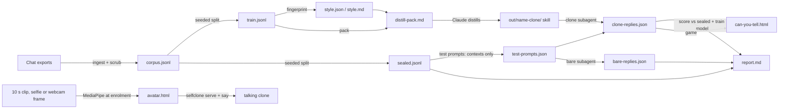

# Architecture

selfclone has three parts that share one workspace folder (`.selfclone/` by default):

1. **A Node CLI** (`scripts/selfclone.mjs`, no runtime dependencies) that does every deterministic step: ingest,
   scrub, split, fingerprint, pack, test prompts, score, game, and the local servers for the face.
2. **An agent skill** (`SKILL.md`) that tells Claude Code (or another agent) how to run the CLI, how to distill
   the persona from the pack, and how to run the clone and a bare model as two isolated subagents for the test.
3. **A face** (`face/`): an enrolment page that runs MediaPipe Face Landmarker at enrolment only (on every
   frame of a short clip, or on one frame), and a standalone `avatar.html` that animates the still frame with a
   2D mesh and real mouth and eye patches from the clip, and needs nothing at run time.

## Source Layout

| Path | Role |
| --- | --- |
| `scripts/selfclone.mjs` | command line entry point |
| `src/ingest/` | one parser per format, a ZIP reader, and `index.mjs` which detects formats and builds records with context and turns |
| `src/scrub.mjs` | secrets scrubber |
| `src/split.mjs` | seeded train / sealed split by turn |
| `src/text.mjs`, `src/functionwords.mjs` | tokenisation and the stylometric feature vector |
| `src/fingerprint.mjs` | `style.json` and `style.md` |
| `src/pack.mjs` | stratified distill pack |
| `src/score.mjs` | the deterministic scorer and report |
| `src/game.mjs` | Can You Tell page |
| `src/face/` | Chrome discovery, MediaPipe cache, local servers, photo bake, avatar build |
| `face/lib/geometry.js` | landmark sets, Delaunay mesh, deformation rig, visemes (shared by Node and the browser) |
| `face/lib/clip.js` | clip enrolment: keyframe scores and selection, similarity and affine fits (shared by Node and the browser) |
| `face/lib/detect.js` | in-browser detection, live checks, crop, the clip collector and the video bake |
| `face/lib/runtime.js` | avatar renderer, animation, speech and audio |
| `face/avatar.html`, `face/enrol.html`, `face/bake.html` | page templates |
| `templates/` | clone skill templates |

## Records And Turns

Each kept message becomes `{id, ts, source, author, text, context, turn, thread}`. Ids are a source prefix and
a hash (`wa-3f9a1c2b7d`), stable across runs. Consecutive messages from the user within five minutes form a
turn. Only the first message of a turn carries `context`, the other person's preceding message or messages (up
to three, up to 800 characters, none if the gap is over 24 hours). Formats with explicit reply links (Telegram,
Slack threads, email `In-Reply-To`) use the exact message replied to.

## The Split

Every turn whose first message has context and whose reply has at least three words is eligible (each Chinese
or Japanese character and each emoji counts as a word, so people who write in those scripts or mostly in emoji
still get a test set). A turn whose reply text appears inside some message's context is not eligible: that
happens with an X self-thread, a Slack thread the user started, or a mail quoting the user's earlier mail, and
sealing it would show the answer in the pack or in another test prompt. Eligible
turns are ordered by `sha1(seed + ":" + turn)` and the first `min(eligible, max(min(20, 0.4 x turns), round(0.15 x turns)))`
are sealed. The order depends only on the seed and the turn ids, so the same corpus always gives the same
split. A SHA-256 of `sealed.jsonl` is stored in `split.json` and checked by `test prompts` and `test score`.
The pack excludes sealed message ids and any training message whose text equals a sealed reply line.

## The Face

### Enrolment

`selfclone face` starts a server on 127.0.0.1 that serves `face/enrol.html` and proxies the pinned MediaPipe
files (`@mediapipe/tasks-vision@1.2.0` from jsDelivr and the float16 `face_landmarker.task` from Google
storage). They are downloaded once into `~/.cache/selfclone/` (override with `SELFCLONE_CACHE`) and checked
against SHA-256 hashes pinned in `src/face/mediapipe.mjs`, both when downloaded and when read from the cache; a
file that does not match is refused. The proxy serves only those pinned names, never an arbitrary URL. Writes
from a page on another site are refused (the `Origin` and `Sec-Fetch-Site` headers are checked, and the bake
endpoint accepts only `application/json`), so a web page cannot post a bake with a fake consent. The page runs
the landmarker in video mode at about five frames per second and shows the checks: exactly one face, yaw and
pitch within 10 degrees (from the facial transformation matrix), mouth closed (jawOpen blendshape and inner-lip
gap), eyes open (eyeBlink blendshapes), face at least 160 px wide, and a glasses warning (horizontal edge
energy across the nose bridge), and enough light (mean luma over the face of at least 50 of 255). Capture is
allowed with one face; unmet checks are listed. A consent step (checkbox plus typed full name) unlocks the bake.
`selfclone bake --photo` runs the same code in headless Chrome through `playwright-core` with the installed
browser.

### Clip Enrolment

"Record a short clip (better)" shows the enrol phrase ("Ah, I see. Oh, why would you move a big cheap boat? Five
fast vans.", which hits AA, E, O, U and W, M B P, and F V), counts down 3-2-1, and records for 10 seconds while a
bar fills. Nothing is recorded to a file: there is no `MediaRecorder`. About 15 times a second the page draws the
camera frame on a canvas, runs the landmarker in video mode, and hands the frame to a `ClipCollector`
(`face/lib/detect.js`), which:

- runs the live checks (frames with no face or several faces are counted and skipped; a clip with another face
  in more than 10% of frames, or a face in less than 40%, is refused);
- measures the frame: 478 landmarks, the 52 blendshapes, head pose, the variance of the Laplacian of luma over
  the mouth (sharpness), and how far the stable points moved since the last frame;
- scores it for each shape (`face/lib/clip.js`): rest (everything relaxed, lips together, eyes open), AA (jaw
  open by blendshape or by the inner-lip gap), E (smile, stretch or a wider mouth than usual), O (funnel or a
  narrower mouth, and open), U and W (pucker or much narrower, nearly closed), M B P (lips pressed, clearly more
  than at rest), F V (lower lip rolled in, clearly more than at rest) and blink (eyes at least 30% less open
  than usual);
- weights each score by quality: sharpness against the clip median (below 20% is refused), head pose against
  the clip's usual pose (more than 10 degrees away is refused), and motion;
- keeps the pixels (a canvas copy) only of frames that are currently among the best three for some shape (five
  for rest), so memory stays bounded whatever the clip length.

When the bar is full, `selectKeyframes` picks the rest frame first. A rest frame must sit in a still, relaxed
stretch, so it is scored by the worst of itself and its two neighbours (a closed frame between two syllables
loses). Each other shape takes its best frame whose stable points (eye corners, nose bridge, forehead and upper
face contour, never the mouth or the eyelids) fit the rest frame within 5% of the inter-ocular distance after
a least-squares similarity transform; the misfit also lowers the score. Shapes with no qualifying frame are left
out.

The rest frame goes through the same crop as a still photo and becomes the base image. Every keyframe is warped
onto the base crop with its similarity transform, and a box is cut around the mouth (lips plus the ring of
landmarks around them, plus 4 px) or, for the blink, around each eye (contour plus two rings). Patches are
encoded as WebP (JPEG where WebP encoding is missing) and sent to Node with their aligned landmarks.
`selfclone bake --video` does the same in headless Chrome: the file is fetched into a blob, a `<video>` element
seeks through it at 15 frames per second, and each frame goes through the same collector. The file is served to
the page from memory by a one-off local server and is not copied.

Node (`buildClip` in `src/face/build.mjs`) validates every patch (a data URL of an image type, under 200 KB of
text, a box inside the frame), and turns each keyframe's aligned landmarks into a sparse displacement of the mesh
points: the measured shift times a weight that is 0 from the nose tip up and 1 from the upper lip down (eyelid
and eye-ring points for the blink), with the soft hair and neck rings following the nearest face-oval point at
half and 15% strength. A shape whose largest shift is over 0.9 mouth widths is treated as a misaligned frame and
dropped. On the test clip the clip data is about 30 KB.

### Bake

The browser crops a square of twice the face height around the face (shoulders included), resizes it to at
most 512 px, encodes a JPEG, and maps all 478 landmarks into crop pixels. Node then builds the mesh:

- vertices: the 468 face landmarks, two soft rings at 1.3x and 1.75x the face oval (hair and neck), and 32
  fixed points on the image border;
- triangles: Delaunay on a pose with the jaw 60% open, so no triangle bridges the lips; triangles inside the
  inner-lip polygon or joining upper and lower inner lip are dropped, which leaves a hole for the mouth;
- the result, the photo, the landmarks, the clip patches and displacements (if any), the glasses flag and the
  consent record (with the method: photo, webcam frame, webcam clip or video file) are embedded as JSON in a
  copy of `face/avatar.html` together with `geometry.js` and `runtime.js`. The file has no external references.

### Animation

Each frame the rig computes vertex positions on the CPU (about 570 vertices):

- **Jaw:** lower-lip points move down by up to 0.38 mouth widths. Other points below the lip line get a weight
  that is 1 near the chin and falls off smoothly toward the cheeks and below the chin, so the neck and
  background stay put.
- **Lips:** width (scale around the mouth centre, falloff by distance), rounding (narrower plus pucker), upper
  lip raise (shows teeth), and lower-lip tuck for F and V.
- **Visemes:** rest (M, B, P), AA, E, I, O, U and W, F and V, and L, T, D, N, S. Each is a set of jaw, width,
  rounding, raise, tuck and teeth values. Parameters move toward the target with a 45 ms time constant (30 ms
  when closing).
- **Blink:** upper-lid points slide to the lower lid (85% of the gap) and the lower lid rises 15%; skin above the
  lid follows with a falloff. The upper-lid texture coordinates shift upward during the blink so the closed lid
  shows skin instead of stretched lashes. With glasses, blinking is off.
- **Head:** small yaw and pitch rotations about an axis behind the face use the landmark depth, so the nose
  moves more than the cheeks; roll pivots below the chin. Sums of slow sines drive idle motion, clamped to
  6 degrees yaw and pitch and 3 degrees roll. Face points move fully, the rings partly, the border not at all.
- **Breathing:** a slow one-pixel rise and fall on the head-weighted points.

### Rendering

The mouth interior is drawn on a 2D canvas under the face: a dark cavity in the shape of the inner-lip ring, a
tongue, and upper and lower teeth bands (the upper band hangs from the rest lip line, the lower band rides on
the jaw), clipped to the opening and shown only for open visemes. The face mesh is drawn on top with WebGL (one
textured draw call) and the mouth hole lets the cavity show through. If WebGL is not available, or with
`?renderer=2d`, a Canvas2D renderer draws each triangle with an affine transform and a slightly enlarged clip
to hide seams.

**Clip patches.** A clip-baked avatar has a third canvas above the face (Canvas2D in both renderers, so WebGL and
the fallback behave the same). Each text viseme maps to a clip shape and an opening: AA, E, O, U and F V to their
own patch, I to E at 80%, L, T, D, N, S to E at 55%, and closed lips inside a word to M B P (a pause between
words is rest). When the shape has a patch, the drawn mouth's parameters aim at rest and two values move
instead, with the same 45 ms and 30 ms time constants: a mix weight per shape and the opening. The mesh gets
the measured displacement of each shape times its weight times the opening, so the lips take the shape seen in
the clip (O and U are round, not lens-shaped). Each patch with weight above 1% is then warped piecewise-affinely
(Delaunay triangles over its own landmarks, about 100 points) onto the current mesh points, masked by the ring
around the lips pulled in by 14% and feathered by 9% of the mouth width (a shadow blur, so it also works without
canvas filters), and drawn from the weakest to the strongest weight so the cross-fade keeps the sum. The blink
works the same way: the eyelid points take the measured closed-eye shape and the two eye patches fade in with
the blink. At load, each patch's colour is matched to the base frame with a per-channel mean and standard
deviation transfer (gain clamped to 0.8 to 1.25) measured on the skin ring between the mask edge and the lips or
the eye opening, at the same landmarks in both images. A shape without a patch uses the drawn mouth, and a
photo-baked avatar has no patch layer at all. `?patches=0` forces the drawn mouth on a clip avatar, for
comparisons. `selfclone.state().mouthPath` says which path drew the mouth (`patch`, `drawn` or `rest`) and
`pathFrames` counts frames per path, for tests.

### Speech

- **Text:** an English letter and digraph table maps text to visemes with durations (vowels 120 ms, consonants
  75 ms, closed lips 85 ms, commas 220 ms, sentence ends 380 ms; other scripts alternate open and half-open per
  character), divided by the `rate` option of `say()` (0.25 to 4, default 1). When the browser speaks the text with `speechSynthesis`, word boundary events re-align the
  timeline; otherwise a timer runs it silently.
- **Audio:** the file is decoded with Web Audio and played through an AnalyserNode. Loudness (RMS) opens the jaw
  and the spectral centroid moves the lips between wide (bright sounds) and round (dark sounds). On a clip
  avatar, bright sounds use the E patch, dark sounds the O patch and the rest the AA patch, opened by loudness.

### Live Mode

`selfclone serve` serves the avatar on 127.0.0.1 with a flag that makes it open a Server-Sent Events stream.
`selfclone say` posts text or audio with a random per-run token from `.selfclone/serve.json` (custom header, so a
web page cannot forge it), and the server pushes it to every open avatar. Requests with a non-local Host
header (DNS rebinding) and writes with another site's `Origin` are refused, pages cannot be framed by another
site, and uploaded audio gets an unguessable address.

## Testing

- `npm test`: unit tests for every parser, the scrubber, the split, the fingerprint, the pack, the scorer, the
  game, the geometry, the clip enrolment (known transforms recovered by the similarity and affine fits,
  alignment untouched by an open jaw, keyframe selection on synthetic sequences and on a recording of the
  landmarker's output for the test clip, patch validation), the CLI, and the security of the local servers and
  the MediaPipe download. No browser
  needed. `tests/unit/real-exports.test.mjs` runs on fictional exports with the quirks real apps produce
  (`tests/fixtures/rosa/`, written by `make-exports.mjs` there).
- `npm run test:e2e`: headless Chrome tests for the photo bake, the offline avatar (network blocked), audio and
  text lip sync, blink, head motion caps, the Canvas2D fallback, live mode, webcam enrolment with Chrome's
  fake camera fed by the test painting, and the clip path: `bake --video` on the synthetic clip
  (`tests/fixtures/mona-lisa-clip.webm`, see `SOURCE.md`), AA drawn from the patch and not the drawn mouth,
  the blink patch, the Canvas2D fallback, `file://` with the network off, the clip consent record, and webcam
  clip enrolment with no `MediaRecorder`. Evidence frames go to `tests/output/`; `docs/make-contact-sheet.mjs`
  renders every shape for both paths into `tests/output/contact-sheet.png`.
