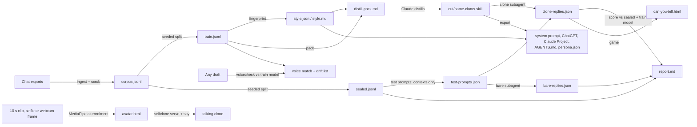

# Architecture

selfclone has three parts that share one workspace folder (`.selfclone/` by default):

1. **A Node CLI** (`scripts/selfclone.mjs`, no runtime dependencies) that does every deterministic step: ingest,
   scrub, split, fingerprint, pack, test prompts, score, game, and the local servers for the face.
2. **An agent skill** (`SKILL.md`) that tells Claude Code (or another agent) how to run the CLI, how to distill
   the persona from the pack, and how to run the clone and a bare model as two isolated subagents for the test.
3. **A face** (`face/`): an enrolment page that runs MediaPipe Face Landmarker at enrolment only (on every
   frame of a short clip, or on one frame), and a standalone `avatar.html` that animates the still frame with a
   2D mesh and real mouth and eye patches from the clip, and needs nothing at run time.

## Source Layout

| Path | Role |
| --- | --- |
| `scripts/selfclone.mjs` | command line entry point |
| `src/ingest/` | one parser per format (WhatsApp, Telegram, Slack, X, email, notes, generic; Discord, Instagram and Messenger, LinkedIn, iMessage, Reddit, Google Chat, Word, blogs), shared HTML helpers, a ZIP reader, `more.mjs` (detection and dispatch for the newer formats) and `index.mjs`, which detects formats and builds records with context and turns |
| `src/kinds.mjs` | the kind of writing of each source: chat message, post and notes, or email |
| `src/voicecheck.mjs` | `selfclone voicecheck`: scores a draft against the training model of the matching kind and writes the drift list |
| `src/export.mjs` | `selfclone export`: the clone as a system prompt, ChatGPT custom instructions, Claude Project instructions, an AGENTS.md section and `persona.json`, each fitted to its size limit |
| `src/scrub.mjs` | secrets scrubber |
| `src/split.mjs` | seeded train / sealed split by turn |
| `src/text.mjs`, `src/functionwords.mjs` | tokenisation and the stylometric feature vector |
| `src/fingerprint.mjs` | `style.json` and `style.md` |
| `src/pack.mjs` | stratified distill pack |
| `src/score.mjs` | the deterministic scorer and report |
| `src/game.mjs` | Can You Tell page |
| `src/face/` | Chrome discovery, MediaPipe cache, local servers, photo bake, avatar build |
| `face/lib/geometry.js` | landmark sets, Delaunay mesh, deformation rig, visemes (shared by Node and the browser) |
| `face/lib/clip.js` | clip enrolment: keyframe scores and selection, similarity and affine fits (shared by Node and the browser) |
| `face/lib/detect.js` | in-browser detection, live checks, crop, the clip collector and the video bake |
| `face/lib/runtime.js` | avatar renderer, animation, speech and audio |
| `face/avatar.html`, `face/enrol.html`, `face/bake.html` | page templates |
| `src/studio/character.mjs` | the drawn character: parameters from landmarks and photo colours, the layered SVG |
| `src/studio/speech.mjs` | narration: Kokoro, ElevenLabs, OpenAI or a file; sentence assembly and WAV |
| `src/studio/scenes.mjs` | scene-file checks and the timeline: absolute times, camera keys, the host's gestures, moods and glances |
| `src/studio/tracks.mjs` | per-frame tracks from the narration: mouth shapes, blinks, emphasis |
| `src/studio/sfx.mjs` | synthesised sound effects and the mix |
| `src/studio/page.mjs` | the frame page and the preview sheet, with the rig code they share |
| `src/studio/explainer.mjs` | narration, the render, the encode (music ducking) and the frame count check |
| `templates/` | clone skill templates; `templates/maintainer-kit/` for `kit init`; the synthetic example profile |
| `src/cli-next.mjs`, `src/errors.mjs` | the Voice CI and Voice Passport commands, their help, structured errors and exit codes |
| `src/consent.mjs` | the consent ledger with scopes and revocation |
| `src/schema.mjs` | a dependency-free JSON Schema validator for `schemas/`, canonical JSON and safe JSON parsing |
| `src/profile/` | channel mapping and the private voice profile (training split only, shrinkage for thin channels) |
| `src/lint/` | the Markdown segmenter, the bounded glob matcher, the policy loader, the lint engine and SARIF output |
| `src/passport/` | the allowlisted public projection, the offline HTML and SVG renderers and the optional PNG |
| `src/kit/` | kit init and check, and the voice delta |
| `src/drift/` | the conversation-level bootstrap over two date windows |
| `schemas/` | JSON Schemas for the profile, the policy, the passport and the lint report |
| `evals/` | behaviour eval cases for `claude plugin eval` |

## Records And Turns

Each kept message becomes `{id, ts, source, author, text, context, turn, thread}`. Ids are a source prefix and
a hash (`wa-3f9a1c2b7d`), stable across runs. Consecutive messages from the user within five minutes form a
turn. Only the first message of a turn carries `context`, the other person's preceding message or messages (up
to three, up to 800 characters, none if the gap is over 24 hours). Formats with explicit reply links (Telegram,
Slack threads, email `In-Reply-To`) use the exact message replied to.

## The Split

Every turn whose first message has context and whose reply has at least three words is eligible (each Chinese
or Japanese character and each emoji counts as a word, so people who write in those scripts or mostly in emoji
still get a test set). A turn whose reply text appears inside some message's context is not eligible: that
happens with an X self-thread, a Slack thread the user started, or a mail quoting the user's earlier mail, and
sealing it would show the answer in the pack or in another test prompt. Eligible
turns are ordered by `sha1(seed + ":" + turn)` and the first `min(eligible, max(min(20, 0.4 x turns), round(0.15 x turns)))`
are sealed. The order depends only on the seed and the turn ids, so the same corpus always gives the same
split. A SHA-256 of `sealed.jsonl` is stored in `split.json` and checked by `test prompts` and `test score`.
The pack excludes sealed message ids and any training message whose text equals a sealed reply line.

## Voicecheck

`voicecheck` reads `train.jsonl` only. It picks the reference units for the requested kind (`--as`): reply
turns for chat, one record each for posts and email, falling back to all the writing when the kind has fewer
than 30 units. It splits the draft into units of the same shape, builds the scorer's model at that number of
units (cached per training set, kind and size), and scores the draft with `scoreTexts`. Below 1,000 words the
match is computed from the feature distance against the feature-only baseline, because function-word
frequencies in a short text are noise (`docs/SCORING.md`, Voicecheck). Each feature with `|z| >= 2` is turned
into a sentence from the person's own numbers and from counts in the draft; related features (words and
characters per message, lowercase starts and the uppercase share, the two emoji, question and exclamation
measures) are merged so one habit gives one instruction. `--json` prints the whole result, and `--min <pct>`
exits with code 2 below the threshold, for use in scripts and hooks.

`fingerprint` also writes a "By Kind Of Writing" table when two or more kinds have 10 or more training messages
each, so the clone can match the channel.

## Export

`export` reads the clone folder (`SKILL.md` and `references/`) and, when present, `style.json` and `report.json`
from the workspace. It turns the fingerprint into concrete rules and ranks them by voice signal: the bare
model's measured drift on that feature when `report.json` exists (`|z|` capped at 5), otherwise how far the
person's habit sits from what a model writes by default (capital starts, final full stops, apostrophes, long
replies). Each target is filled block by block in priority order: the AI clone disclosure (required; a limit too
small for it is an error), the ranked rules, the modes, the hard limits, the voice details, the opinions,
what is unknown, the examples. The first item that does not fit ends the export, so cutting to a size limit
always drops the least important text and never the disclosure. ChatGPT and AGENTS.md exports carry no
message ids. Sizes are counted in characters, or in UTF-8 bytes for AGENTS.md (Codex counts bytes).

## The Face

### Enrolment

`selfclone face` starts a server on 127.0.0.1 that serves `face/enrol.html` and proxies the pinned MediaPipe
files (`@mediapipe/tasks-vision@1.2.0` from jsDelivr and the float16 `face_landmarker.task` from Google
storage). They are downloaded once into `~/.cache/selfclone/` (override with `SELFCLONE_CACHE`) and checked
against SHA-256 hashes pinned in `src/face/mediapipe.mjs`, both when downloaded and when read from the cache; a
file that does not match is refused. The proxy serves only those pinned names, never an arbitrary URL. Writes
from a page on another site are refused (the `Origin` and `Sec-Fetch-Site` headers are checked, and the bake
endpoint accepts only `application/json`), so a web page cannot post a bake with a fake consent. The page runs
the landmarker in video mode at about five frames per second and shows the checks: exactly one face, yaw and
pitch within 10 degrees (from the facial transformation matrix), mouth closed (jawOpen blendshape and inner-lip
gap), eyes open (eyeBlink blendshapes), face at least 160 px wide, and a glasses warning (horizontal edge
energy across the nose bridge), and enough light (mean luma over the face of at least 50 of 255). Capture is
allowed with one face; unmet checks are listed. A consent step (checkbox plus typed full name) unlocks the bake.
`selfclone bake --photo` runs the same code in headless Chrome through `playwright-core` with the installed
browser.

### Clip Enrolment

"Record a short clip (better)" shows the enrol phrase ("Ah, I see. Oh, why would you move a big cheap boat? Five
fast vans.", which hits AA, E, O, U and W, M B P, and F V), counts down 3-2-1, and records for 10 seconds while a
bar fills. Nothing is recorded to a file: there is no `MediaRecorder`. About 15 times a second the page draws the
camera frame on a canvas, runs the landmarker in video mode, and hands the frame to a `ClipCollector`
(`face/lib/detect.js`), which:

- runs the live checks (frames with no face or several faces are counted and skipped; a clip with another face
  in more than 10% of frames, or a face in less than 40%, is refused);
- measures the frame: 478 landmarks, the 52 blendshapes, head pose, the variance of the Laplacian of luma over
  the mouth (sharpness), and how far the stable points moved since the last frame;
- scores it for each shape (`face/lib/clip.js`): rest (everything relaxed, lips together, eyes open), AA (jaw
  open by blendshape or by the inner-lip gap), E (smile, stretch or a wider mouth than usual), O (funnel or a
  narrower mouth, and open), U and W (pucker or much narrower, nearly closed), M B P (lips pressed, clearly more
  than at rest), F V (lower lip rolled in, clearly more than at rest) and blink (eyes at least 30% less open
  than usual);
- weights each score by quality: sharpness against the clip median (below 20% is refused), head pose against
  the clip's usual pose (more than 10 degrees away is refused), and motion;
- keeps the pixels (a canvas copy) only of frames that are currently among the best three for some shape (five
  for rest), so memory stays bounded whatever the clip length.

When the bar is full, `selectKeyframes` picks the rest frame first. A rest frame must sit in a still, relaxed
stretch, so it is scored by the worst of itself and its two neighbours (a closed frame between two syllables
loses). Each other shape takes its best frame whose stable points (eye corners, nose bridge, forehead and upper
face contour, never the mouth or the eyelids) fit the rest frame within 5% of the inter-ocular distance after
a least-squares similarity transform; the misfit also lowers the score. Shapes with no qualifying frame are left
out.

The rest frame goes through the same crop as a still photo and becomes the base image. Every keyframe is warped
onto the base crop with its similarity transform, and a box is cut around the mouth (lips plus the ring of
landmarks around them, plus 4 px) or, for the blink, around each eye (contour plus two rings). Patches are
encoded as WebP (JPEG where WebP encoding is missing) and sent to Node with their aligned landmarks.
`selfclone bake --video` does the same in headless Chrome: the file is fetched into a blob, a `<video>` element
seeks through it at 15 frames per second, and each frame goes through the same collector. The file is served to
the page from memory by a one-off local server and is not copied.

Node (`buildClip` in `src/face/build.mjs`) validates every patch (a data URL of an image type, under 200 KB of
text, a box inside the frame), and turns each keyframe's aligned landmarks into a sparse displacement of the mesh
points: the measured shift times a weight that is 0 from the nose tip up and 1 from the upper lip down (eyelid
and eye-ring points for the blink), with the soft hair and neck rings following the nearest face-oval point at
half and 15% strength. A shape whose largest shift is over 0.9 mouth widths is treated as a misaligned frame and
dropped. On the test clip the clip data is about 30 KB.

### Bake

The browser crops a square of twice the face height around the face (shoulders included), resizes it to at
most 512 px, encodes a JPEG, and maps all 478 landmarks into crop pixels. Node then builds the mesh:

- vertices: the 468 face landmarks, two soft rings at 1.3x and 1.75x the face oval (hair and neck), and 32
  fixed points on the image border;
- triangles: Delaunay on a pose with the jaw 60% open, so no triangle bridges the lips; triangles inside the
  inner-lip polygon or joining upper and lower inner lip are dropped, which leaves a hole for the mouth;
- the result, the photo, the landmarks, the clip patches and displacements (if any), the glasses flag and the
  consent record (with the method: photo, webcam frame, webcam clip or video file) are embedded as JSON in a
  copy of `face/avatar.html` together with `geometry.js` and `runtime.js`. The file has no external references.

### Animation

Each frame the rig computes vertex positions on the CPU (about 570 vertices):

- **Jaw:** lower-lip points move down by up to 0.38 mouth widths. Other points below the lip line get a weight
  that is 1 near the chin and falls off smoothly toward the cheeks and below the chin, so the neck and
  background stay put.
- **Lips:** width (scale around the mouth centre, falloff by distance), rounding (narrower plus pucker), upper
  lip raise (shows teeth), and lower-lip tuck for F and V.
- **Visemes:** rest (M, B, P), AA, E, I, O, U and W, F and V, and L, T, D, N, S. Each is a set of jaw, width,
  rounding, raise, tuck and teeth values. The jaw never opens past 58% of its range (AA), so the mouth talks
  and never screams. Rounding (O, U) narrows the mouth, gathers the corners toward the centre, levels a smiling
  lip line, lifts the middle of the upper lip and lowers the sides of the lower lip, so the opening is round,
  not a lens. The corners also come in a little as the jaw drops. Each side is measured to its own corner,
  since mouths are rarely symmetric.
- **Timing:** each parameter follows its target as a critically damped spring (solved exactly per frame; it
  settles in about 80 ms, a little faster when closing), so shapes ease in and out without overshoot. For the
  drawn mouth the text target leans toward the next shape over the last 60 ms of a segment, and L, T, D, N, S
  keep half the shape of the vowel next to them (coarticulation).
- **Blink:** about 170 ms in all, with the eye more than half shut for about 100 ms (50 ms to close, 30 ms
  closed, 90 ms to reopen). The upper lid slides down over the eye on the overlay canvas (see Rendering); the
  mesh lids only sink by a fifth of the gap under it. With glasses, blinking is off.
- **Head:** small yaw and pitch rotations about an axis behind the face use the landmark depth, so the nose
  moves more than the cheeks; roll pivots below the chin. Sums of slow sines drive idle motion, clamped to
  6 degrees yaw and pitch and 3 degrees roll. Face points move fully, the rings partly, the border not at all.
- **Breathing:** a slow one-pixel rise and fall on the head-weighted points.

### Rendering

The mouth interior is drawn on a 2D canvas under the face, in the shape of the inner-lip ring, with colours
taken from the photo at load: the lip colour (sampled from the body of both lips) is pulled toward red and
darkened to make a near-black base, a soft rim of a warmer, lighter shade inside the lips, and a faint
dark-red glow low in the mouth for the tongue on open shapes. Upper teeth only, and only on open, spread
shapes (AA, E, I, a little on L): the middle of the upper lip line, tinted from skin and lip tones, mostly
desaturated, no brighter than the skin, at under half opacity, with the upper lip's shadow over their top.
Every shape is softened with a shadow blur (which also works where canvas filters are missing), so nothing in
the mouth has a hard edge. The face mesh is drawn on top with WebGL and the mouth hole lets the cavity show
through. A strip of triangles across the hole (upper to lower inner lip) is drawn from the photo itself with
an opacity that is 1 while the lips touch and fades out as they part, so the rest pose and M, B, P are exactly
the photo, with no drawn line between the lips. If WebGL is not available, or with `?renderer=2d`, a Canvas2D
renderer draws each triangle with an affine transform and a slightly enlarged clip to hide seams.

**Drawn blink.** A photo avatar draws the blink on a canvas above the face. The lid is the band between the
upper lid line (raised a little at the middle, to cover the painted lash line) and a lid edge that moves from
the upper to the lower lid line. It is filled with the photo's own skin from just above the lid, mirrored
across the top of the band so it joins without a seam, evened out toward the skin colour sampled just above the
crease and shaded slightly darker toward the lashes, and feathered with a blurred mask. A soft lash line,
darkened from the colour of the lid line itself, runs along the lid edge, thickest in the middle. Both
renderers use the same overlay. A clip avatar with a closed-eye patch uses the patch instead.

**Clip patches.** A clip-baked avatar has a third canvas above the face (Canvas2D in both renderers, so WebGL and
the fallback behave the same). Each text viseme maps to a clip shape and an opening: AA, E, O, U and F V to their
own patch, I to E at 80%, L, T, D, N, S to E at 55%, and closed lips inside a word to M B P (a pause between
words is rest). When the shape has a patch, the drawn mouth's parameters aim at rest and two values move
instead, with 45 ms and 30 ms time constants (opening and closing): a mix weight per shape and the opening. The mesh gets
the measured displacement of each shape times its weight times the opening, so the lips take the shape seen in
the clip (O and U are round, not lens-shaped). Each patch with weight above 1% is then warped piecewise-affinely
(Delaunay triangles over its own landmarks, about 100 points) onto the current mesh points, masked by the ring
around the lips pulled in by 14% and feathered by 9% of the mouth width (a shadow blur, so it also works without
canvas filters), and drawn from the weakest to the strongest weight so the cross-fade keeps the sum. The blink
works the same way: the eyelid points take the measured closed-eye shape and the two eye patches fade in with
the blink. At load, each patch's colour is matched to the base frame with a per-channel mean and standard
deviation transfer (gain clamped to 0.8 to 1.25) measured on the skin ring between the mask edge and the lips or
the eye opening, at the same landmarks in both images. A shape without a patch uses the drawn mouth, and a
photo-baked avatar has no patch layer at all. `?patches=0` forces the drawn mouth on a clip avatar, for
comparisons. `selfclone.state().mouthPath` says which path drew the mouth (`patch`, `drawn` or `rest`) and
`pathFrames` counts frames per path, for tests.

### Speech

- **Text:** an English letter and digraph table maps text to visemes with durations (vowels 120 ms, consonants
  75 ms, closed lips 85 ms, commas 220 ms, sentence ends 380 ms; other scripts alternate open and half-open per
  character), divided by the `rate` option of `say()` (0.25 to 4, default 1). When the browser speaks the text with `speechSynthesis`, word boundary events re-align the
  timeline; otherwise a timer runs it silently.
- **Audio:** the file is decoded with Web Audio and played through an AnalyserNode. Loudness (RMS) opens the jaw
  and the spectral centroid moves the lips between wide (bright sounds) and round (dark sounds). On a clip
  avatar, bright sounds use the E patch, dark sounds the O patch and the rest the AA patch, opened by loudness.

### Live Mode

`selfclone serve` serves the avatar on 127.0.0.1 with a flag that makes it open a Server-Sent Events stream.
`selfclone say` posts text or audio with a random per-run token from `.selfclone/serve.json` (custom header, so a
web page cannot forge it), and the server pushes it to every open avatar. Requests with a non-local Host
header (DNS rebinding) and writes with another site's `Origin` are refused, pages cannot be framed by another
site, and uploaded audio gets an unguessable address.

## Video Export

`selfclone video` (`src/face/video.mjs`) turns a baked avatar into a clip for screen recordings and tutorials.
The page is rebuilt from the avatar's embedded data with the current runtime. ffmpeg decodes the user's audio; Node measures loudness and spectral
centroid every 10 ms with the same mapping the live audio mode uses (`sayFeatures()`); headless Chrome renders
each frame on a paused clock (`?export=circle|square`, the face only); the raw frames are piped back to
ffmpeg, which writes WebM VP9 with alpha (transparent background) or MP4 H.264, with the original audio muxed in.

Safeguards, each covered by `tests/unit/video.test.mjs` and `tests/e2e/video.test.mjs`: the consent record must
have a statement and a date, and its photo SHA-256 must match the embedded face; there is no text input, only the
user's own audio; and `--max-minutes` caps the length (default 10, at most 60). The policy behind these
rules is in [`ETHICS.md`](../ETHICS.md).

## Studio (Explainer Videos)

`selfclone character` runs the same headless bake as `bake --photo` (or `--video`) to get the 478 landmarks and
the crop, decodes the crop with ffmpeg, and turns them into a small parameter file: face aspect, eye spacing and
height, nose and mouth height, mouth width (each a ratio measured on the landmarks), and colours sampled as
medians of small discs (cheeks and forehead for skin, above the hairline for hair, the lip bodies, the shoulders
and the collar). A photo whose skin and lips have almost no saturation is treated as black and white: hair and
clothes keep their lightness, the skin tone comes from a six-step ramp. `characterSvg()` draws the character in a
600 x 720 box from those numbers and a hair style; every mouth shape (rest, small, wide, open, round, pucker), both
eye states and both poses are groups in the one SVG, ids prefixed per instance.

The character is a rig. The torso holds two jointed arms (the upper arm turns at the shoulder, the forearm at the
elbow, three hand shapes are swapped), with the shoulders drawn again over the tops of the arms so they come out
from under the jacket. A gesture is a pair of angles and a hand per arm (`GESTURES`); the page blends from one
to the next over 0.45 s. The face's features are one group that shifts toward where the host looks while the hair
fringe shifts less and the irises more, which reads as a head turn. The brows rotate and lift per mood
(`MOOD_FACES`).

`buildTimeline` resolves every `line` + `at` into seconds and adds the host's automatic behaviour: a gesture per
sentence from a seeded pool, a point toward items that land at least 0.15 of the width to its side (dropped
after 1.5 s), and a glance at every item. Gesture events have priorities (written cues, then points, then
sentence gestures); of two closer than 0.8 s, the higher one stays. `emphasisTrack` finds loudness peaks in the
top fifth of the speech, at least 0.45 s apart, and turns each into a short bump that the page uses for a nod, a
brow lift and a beat of the gesturing hand.

`selfclone explainer` checks the scene file (`checkScenes`), gets the narration, measures loudness and spectral
centroid every 10 ms with the same code as `selfclone video`, and builds two tracks per frame: the mouth shape
(loudness relative to the 90th percentile of voiced frames picks the opening, the centroid relative to its median
picks round or wide; rest outside spoken lines; held for two frames at 24 fps) and blinks (seeded, every 2.2 to
5.5 s). The page (`explainerHtml`) holds every scene as DOM and SVG and exposes `studio.render(frame)`, a pure
function of the frame number: camera transform, item entrances, the character's mouth, eyes, head tilt and bob
(on twos), the caption and the line-boil seed (an `feTurbulence` displacement on items and the character, three
seeds cycled at 8 a second). Paper grain and a soft-light mottle are fixed noise tiles above the scenes.

Scenery (`backdrops.mjs`) is generated SVG, seeded by the title and scene: the backdrop is drawn 1.3 times the
frame and moved at 45% of the camera's shift and zoom, so it lags behind like a far layer; particles are moved a
little more than the camera. Parts that live on their own carry a class the page animates on twos (drift,
twinkle, float, roll).

Sound effects are synthesised from the timeline (`sfx.mjs`: a pitch-dropping sine for a pop, swept band noise
for a whoosh, bursts of high-passed noise for pencil strokes, two sine partials for a chime), mixed under the
narration and soft-clipped. A music track is looped, faded and compressed by the narration as a sidechain in
ffmpeg, so it dips while the narrator speaks.

Narration is spoken one sentence at a time, trimmed of edge silence and joined with fixed pauses (0.35 s before a
scene's first line, 0.3 s between lines, 0.45 s after the last plus the scene's `hold`), so every caption and cue
time is exact. It is cached under `.selfclone/studio/` by a hash of the voice, the lines and the holds.

Rendering uses headless Chrome with `--disable-gpu` (SVG filters are several times faster in software than
through SwiftShader) and the network blocked. Each frame is captured as JPEG and piped to ffmpeg (H.264 and AAC).
The encoded file's frames are then counted with ffprobe; a mismatch deletes the output.

### Cast, Dialogue And The Rest Of The Studio

- **Cast.** `checkScenes` reads a cast (zero or more named characters, each a file, `random:<seed>` or an object,
  with a voice and a bust or full body) and normalises every line to `{who, text}`. `buildTimeline` gives each
  character on screen its own gestures, moods, glances, walk keys and listening looks (toward whoever speaks).
  `castTracks` builds mouth, blink and emphasis tracks per speaker from only that speaker's lines.
- **Random people.** `randomCharacter(seed)` draws skin, hair colour and style, outfit, facial hair, glasses and
  face proportions from natural ranges; its consent record says it is fictional.
- **Full body and walking.** The full body adds a waist, a belt and jointed legs to the same rig. While a
  character's x changes, the page drives a 1.7-steps-a-second cycle: thighs swing, knees bend on the forward
  leg, arms swing opposite and the body bobs.
- **Lip sync from text.** `phonemeSegments` turns each line into IPA with the phonemizer that comes with
  kokoro-js, clause by clause so the pauses survive, and maps the sounds to visemes; without the phonemizer,
  `mouthTrack` uses the photo avatar's letter table (`textToVisemes`). It aligns them to the audio piecewise, matching the text's commas and stops to silences in the
  voice, and lets loudness open or close the mouth.
- **Props and charts.** `props.mjs` holds 60 props as 100 x 100 SVG in the house style. `charts.mjs` draws bar,
  line and pie charts whose parts carry classes the page grows in turn.
- **Manim.** `manim.mjs` finds Manim (`SELFCLONE_MANIM`, selfclone's own venv, or `manim` / `python -m manim`)
  and renders each block to a transparent WebM at the video's frame rate. ffmpeg splits it into PNG frames,
  cached by code and size, and the page shows them frame by frame; the render waits for each image to decode.
- **3D.** A scene's `three` module draws with three.js 0.170 (a dependency). The main render runs Chrome without
  the GPU, because SVG filters are faster on the CPU. So `three.mjs` renders the 3D frames first, in a second
  Chrome with the GPU on: ANGLE on D3D11 or Metal, or SwiftShader with `SELFCLONE_GL=swiftshader`.
  - The 3D page is served from memory with an import map: `three`, `three/addons/`, and `selfclone/3d` (that is,
    `src/studio/three/`: `stage.js` for the renderer, post-processing and timed labels; `kit.js` for helpers).
    The module's own folder is served as `/user/`.
  - Frames go to `three-<key>/` as JPEG (PNG when transparent). The key hashes the module, the modules it imports,
    the assets beside it, the kit, the three.js version, the size and the scene's line timings.
  - A layer runs from its scene's start to its end, plus the next scene's transition.
  - `--preview` renders only the frames its stills need, and the full render fills in the rest.
  - The page shows the layer as an image under the world layer, like a Manim clip. The player exports it as WebM.
- **Parallel rendering.** Every frame is a pure function of its number, so `renderExplainer` splits the frames
  into runs, one page per worker, each encoding its own H.264 segment. ffmpeg joins them without re-encoding and
  adds the sound; the frames of the joined file are then counted.
- **Preview.** `renderPreview` renders three stills per scene into one sheet, so Claude can check a storyboard in
  seconds.
- **Storyboard warnings.** `lint.mjs` estimates each item's box from its viewBox, font size or chart shape. It
  warns about overlaps (ignoring items on the same centre, which are layered on purpose), items off the frame,
  under the captions or over a character, and empty or rushed scenes.
- **Aspect.** Characters and text are sized against `min(height, 1.2 x width)`, so a 9:16 frame keeps them inside
  its width; in tall frames the captions sit a little higher, over the presenter's torso.
- **Interactive player.** `exportHtmlPlayer` reuses the frame page with a player around it. The sound
  (narration, effects, ducked music) is embedded as AAC; each Manim block becomes a transparent WebM clip that
  stays within 0.2 s of the sound. Every animation frame renders the frame for the sound's current time, so the
  page plays, pauses, scrubs and jumps to chapters with no separate animation code.
- **Ambient music.** `ambientMusic` synthesises a I-V-vi-IV pad (detuned voices, slow swells, two echo taps, a
  soft limiter), which the mix ducks like any music.
- **Kokoro.** It is fetched at a pinned Hugging Face revision, and the model file is checked against a pinned
  SHA-256 before use.

## Testing

- `npm test`: unit tests for every parser (`tests/unit/formats-more.test.mjs` for the newer formats, on
  synthetic exports built in the test), the scrubber, the split, the fingerprint, the pack, the scorer,
  voicecheck (same and different authors, planted drifts, short texts, the per-kind reference, the CLI), the
  exports (size limits, rule order, the disclosure surviving truncation, the CLI), the game, the geometry, the clip enrolment (known transforms recovered by the similarity and affine fits,
  alignment untouched by an open jaw, keyframe selection on synthetic sequences and on a recording of the
  landmarker's output for the test clip, patch validation), the CLI, and the security of the local servers and
  the MediaPipe download. No browser
  needed. `tests/unit/real-exports.test.mjs` runs on fictional exports with the quirks real apps produce
  (`tests/fixtures/rosa/`, written by `make-exports.mjs` there).
- `npm run test:e2e`: headless Chrome tests for the photo bake, the offline avatar (network blocked), audio and
  text lip sync, blink, head motion caps, the Canvas2D fallback, live mode, webcam enrolment with Chrome's
  fake camera fed by the test painting, and the clip path: `bake --video` on the synthetic clip
  (`tests/fixtures/mona-lisa-clip.webm`, see `SOURCE.md`), AA drawn from the patch and not the drawn mouth,
  the blink patch, the Canvas2D fallback, `file://` with the network off, the clip consent record, and webcam
  clip enrolment with no `MediaRecorder`. Evidence frames go to `tests/output/`; `tools/make-contact-sheet.mjs`
  renders rest, AA, E, O, U, M B P, F V, a half-closed and a closed blink for both bakes, in WebGL and Canvas2D,
  into `tests/output/contact-sheet.png` (and a zoomed `contact-sheet-mouth.png`; `--name before` keeps a
  separate copy for comparisons). `npm run gif` makes the README media under a paused fake clock.
